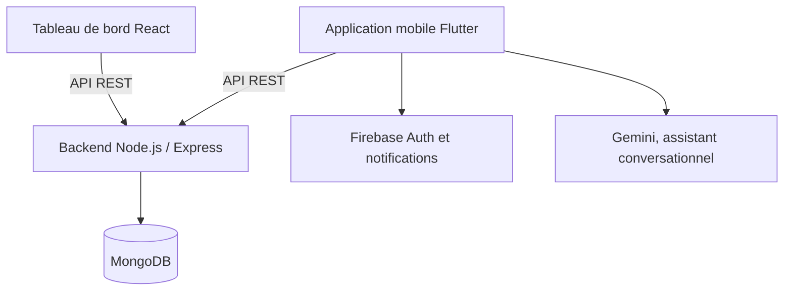

# FitYes — plateforme mobile de fitness et de bien-être

<p align="center">
  
</p>

<p align="center">
  <strong>Application Flutter pour accompagner les entraînements, la nutrition et le suivi des objectifs, avec un tableau de bord web d’administration.</strong>
</p>

<p align="center">
  
  
  
  
</p>

<p align="center">
  <a href="demo/FitYes-demo.mp4">▶ Voir la démonstration</a> ·
  <a href="docs/FitYes-defense-presentation.pdf">Présentation de soutenance</a>
</p>

---

## Sommaire

1. [Présentation](#présentation)
2. [Fonctionnalités](#fonctionnalités)
3. [Architecture](#architecture)
4. [Technologies](#technologies)
5. [Démonstration et présentation](#démonstration-et-présentation)
6. [Installation](#installation)
7. [Configuration](#configuration)
8. [Sécurité et limites connues](#sécurité-et-limites-connues)
9. [Organisation du dépôt](#organisation-du-dépôt)
10. [Auteure](#auteure)

## Présentation

**FitYes** est un projet de fin d’études consacré au bien-être et à la remise en forme. La solution réunit une application mobile destinée aux adhérents et un tableau de bord web pour l’administration. L’application aide à organiser des repas et des séances d’entraînement, suivre des objectifs et visualiser sa progression.

| Espace | Rôle |
|---|---|
| Application mobile | Inscription et connexion, profil, objectifs, repas, entraînements, progression, notifications et assistant conversationnel |
| Administration web | Consultation de statistiques, gestion des utilisateurs et publication de conseils |
| API et données | Services Node.js/Express et stockage MongoDB |

## Fonctionnalités

- Création de compte et connexion, avec authentification Firebase/Google dans l’application mobile.
- Profil utilisateur et objectifs personnalisés.
- Planification des repas et consultation d’informations nutritionnelles.
- Plans d’entraînement, exercices et suivi des progrès.
- Notifications et assistant conversationnel basé sur Gemini.
- Interface d’administration React avec statistiques, gestion des utilisateurs et conseils.
- API REST Node.js/Express et persistance MongoDB.

## Architecture



## Technologies

| Composant | Technologies |
|---|---|
| Mobile | Flutter, Dart, Firebase Authentication, Firebase Messaging |
| Administration | React, Vite, Axios, Recharts |
| Backend | Node.js, Express, JWT, Mongoose |
| Base de données | MongoDB |

## Démonstration et présentation

- [Lire ou télécharger la vidéo de démonstration](demo/FitYes-demo.mp4)
- [Consulter la présentation de soutenance (PDF)](docs/FitYes-defense-presentation.pdf)

## Installation

Prérequis : Flutter SDK, Node.js/npm, MongoDB et les paramètres de projet Firebase nécessaires aux fonctions utilisées.

### 1. Backend

Depuis la racine du dépôt :

```powershell
cd backend
Copy-Item .env.example .env
npm install
npm start
```

Complétez `backend/.env` avec vos propres valeurs avant de lancer le serveur. Il écoute sur le port `5003` par défaut.

### 2. Tableau de bord web

Dans un autre terminal :

```powershell
cd admin-dashboard
Copy-Item .env.example .env
npm install
npm run dev
```

Vite démarre généralement le tableau de bord sur `http://localhost:5173`. L’URL de l’API se règle avec `VITE_API_URL` dans `admin-dashboard/.env`.

### 3. Application Flutter

Dans un autre terminal :

```powershell
cd mobile-app
flutter pub get
flutter run --dart-define=API_BASE_URL=http://10.0.2.2:5003 --dart-define=GEMINI_API_KEY=VOTRE_CLE_GEMINI
```

`10.0.2.2` permet à l’émulateur Android d’accéder au serveur exécuté sur l’ordinateur. Pour un appareil physique ou une autre cible, remplacez l’adresse par celle du serveur accessible depuis cet appareil. N’inscrivez pas une clé Gemini réelle dans le code source.

## Configuration

Le backend utilise les variables documentées dans [`backend/.env.example`](backend/.env.example), notamment l’URI MongoDB, le secret JWT, les paramètres du serveur et, si nécessaire, les identifiants mail et Firebase Admin.

La connexion au tableau de bord utilise l’endpoint de connexion du backend et n’intègre aucun compte de démonstration codé en dur. Utilisez un compte administrateur provisionné dans votre base de données.

## Sécurité et limites connues

Ce dépôt contient un prototype académique. Avant toute mise en production, il faut notamment vérifier les autorisations côté API, les règles Firebase/MongoDB, la gestion des secrets, les limites de requêtes et le transport HTTPS. Les identifiants Firebase côté client sont une configuration d’application ; les clés privées de service, mots de passe, URI MongoDB et clés Gemini restent hors du dépôt.

Les intégrations Firebase, MongoDB, mail et Gemini nécessitent vos propres projets et secrets. La vidéo et le PDF sont inclus comme documents de présentation du projet.

## Organisation du dépôt

```text
.
├── admin-dashboard/     # Interface d'administration React
├── backend/             # API Node.js / Express et modèles MongoDB
├── demo/                # Vidéo de démonstration
├── docs/                # Présentation de soutenance
└── mobile-app/          # Application Flutter
```

## Auteure

**Sarra Askri** — projet de fin d’études, Faculté des Sciences de Bizerte, Université de Carthage.

<div align="center">
<sub>Si ce projet vous est utile, n'hésitez pas à lui laisser une ⭐</sub>
</div>

